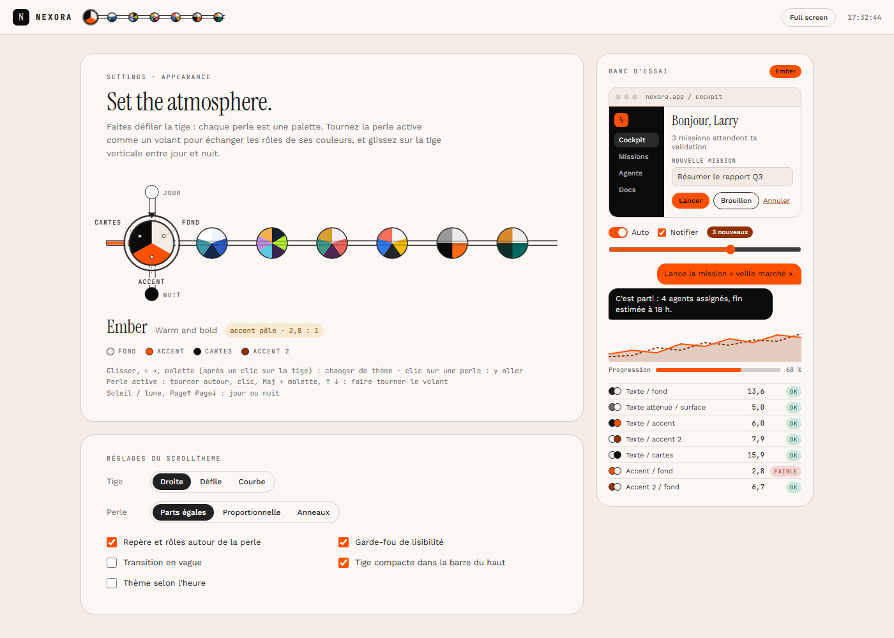
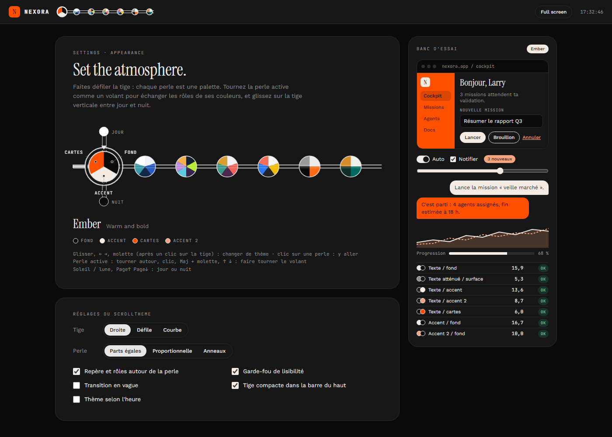
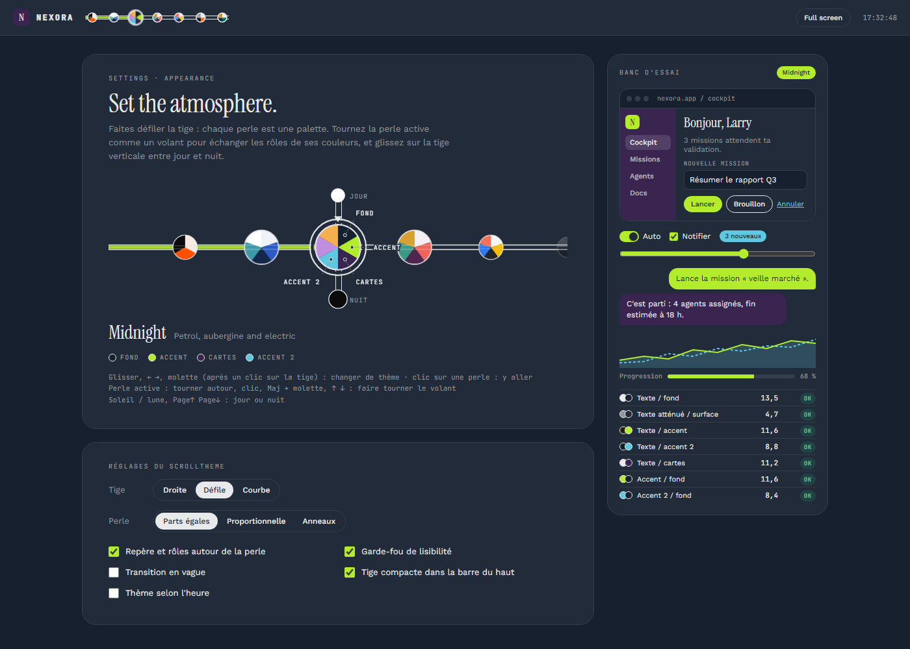
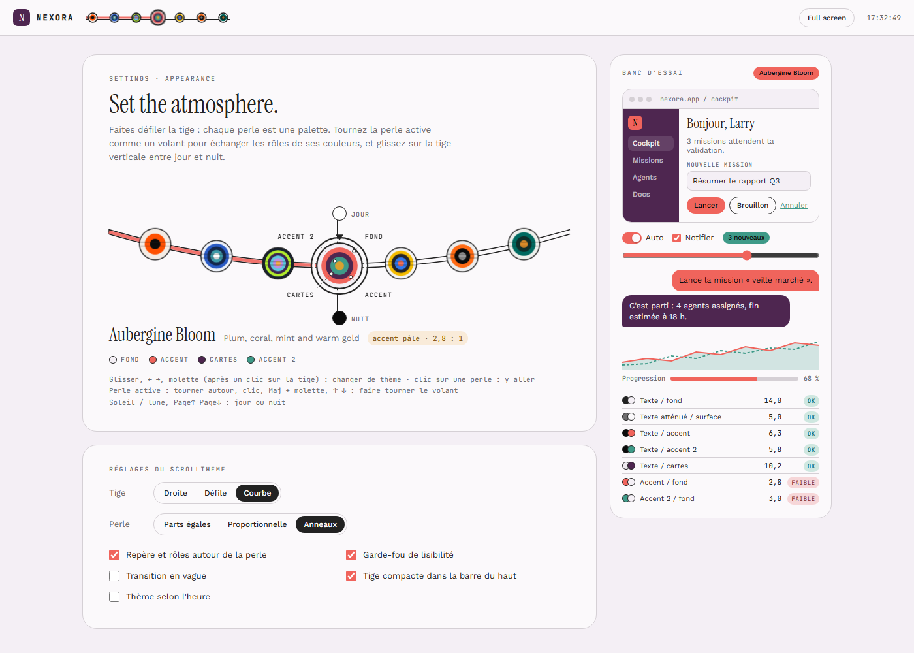
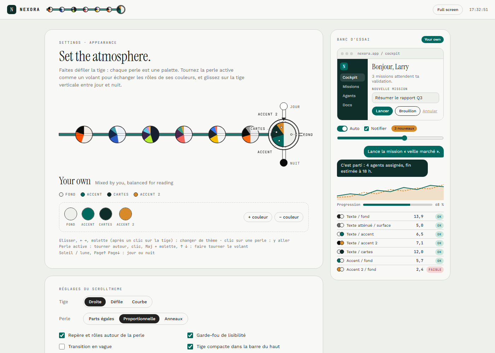

# ScrollTheme

**Démo : https://skisofrene2001.github.io/ScrollTheme/**

Un sélecteur de thème en forme de collier : une tige sur laquelle sont enfilées des perles, une par palette.
On fait défiler la tige pour changer d'ambiance, et on tourne la perle active comme un volant pour échanger les rôles de ses couleurs.

Un seul fichier, `index.html` (HTML, CSS et JavaScript sans dépendance). Ouvrez-le dans un navigateur.

## Utilisation

| Geste | Effet |
| --- | --- |
| Glisser, ← →, molette (après un clic sur la tige) | Changer de thème (fondu continu, puis aimantation sur la perle la plus proche) |
| Clic sur une perle | Aller à ce thème |
| Tourner autour de la perle active, clic, Maj + molette, ↑ ↓ | Faire tourner le volant : chaque couleur change de rôle |
| Soleil / lune, Page↑ Page↓ | Jour ou nuit |

## En images

| Perle tournée d'un cran : les couleurs changent de rôle | Tige qui défile, Midnight en mode nuit |
| --- | --- |
|  |  |
| **Tige courbe et perles en anneaux** | **Palette « Your own » modifiable, perles proportionnelles** |
|  |  |

## Comment ça marche

Chaque palette se lit dans l'ordre des parts de la perle, en sens horaire depuis le haut :
part 0 = fond, 1 = accent, 2 = cartes, 3 = accent 2. Tourner la perle d'un cran décale chaque couleur vers la part suivante.
Les couleurs dérivées (texte, surfaces, bordures, texte sur accent) sont recalculées à chaque cran pour rester lisibles (contraste WCAG).

## Réglages

- Tige : droite, qui défile, ou courbe
- Perle : parts égales, proportionnelle, ou anneaux
- Repère et rôles écrits autour de la perle active
- Garde-fou de lisibilité (saute les crans illisibles)
- Transition en vague (View Transitions API)
- Tige compacte dans la barre du haut
- Thème selon l'heure
- Palette « Your own » modifiable

Le panneau « Banc d'essai » montre le thème sur de vrais composants et affiche les contrastes en direct.

## Ajouter un thème

Ajoutez une entrée `{ name, desc, swatch }` au tableau `THEMES`, en rangeant les couleurs dans l'ordre fond, accent, cartes, accent 2.
